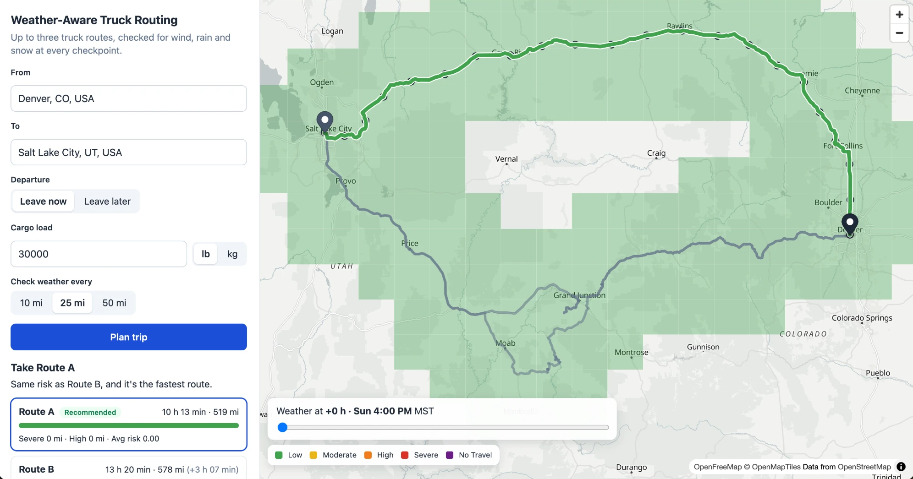
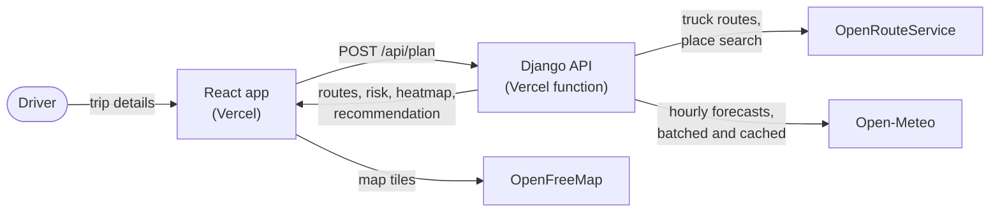

# Weather-Aware Truck Routing

Plan a truck trip and see up to three routes, each checked for wind, rain and snow at every checkpoint along the way, with the forecast for the hour the truck will actually be there. The app recommends the route with the least weather risk, in the order the spec asks for, and explains why.

<!-- Placeholders to fill before submitting (search for TODO_):
  TODO_LOOM_URL      the Loom walkthrough
  TODO_SCREENSHOT    add docs/screenshot.png (Denver to Salt Lake City with the heatmap), then uncomment the image below
-->

- **Live app:** https://weather-aware-truck-routing-five-black.vercel.app
- **API health check:** https://weather-routing-api.vercel.app/api/health (the first request after a quiet spell starts the server, so it can take a few extra seconds)
- **Walkthrough (Loom):** [TODO_LOOM_URL](TODO_LOOM_URL)

<!-- TODO_SCREENSHOT:

-->

## What it does

- **Trip form:** origin and destination with place search, departure (leave now, or a local time at the origin), cargo load in lb or kg, and a weather check every 10, 25 or 50 miles.
- **Up to three truck routes** from OpenRouteService's truck profile, using the truck's gross weight to avoid weight-restricted roads.
- **Checkpoints** every N miles, plus the origin and destination, each with its ETA and the forecast for that hour.
- **Risk per checkpoint** from the spec's table: the worst of wind, rain and snow, with the load rules applied to wind.
- **Recommendation** in the spec's order: fewest Severe miles, then fewest High miles, then lowest average risk, then shortest time. Routes with any No Travel stretch go last. A one-line reason says why the winner won.
- **Map:** routes coloured by risk, checkpoint popups (ETA, level, the condition behind it, and whether the load raised it), and a weather heatmap along the corridor with a **0-48 h slider**.
- **Helpful failures:** every problem comes with a plain message and one-tap fixes ("Leave now", "Use 25 mi", "Use Rawlins, WY instead", "Try again"), never a bare error.

## How it works



One request plans the whole trip, in eight steps (`backend/planner/service.py`):

1. Check the input and the departure window; find the origin's time zone.
2. Get up to three truck routes: ORS's own alternatives for short trips, detour points beside the midpoint for longer ones (ORS only offers alternatives under 100 km).
3. Place checkpoints every N miles along the road and work out each ETA from ORS's step durations.
4. Round checkpoints to a weather grid and size the heatmap so one plan stays within 500 weather locations.
5. Fetch hourly forecasts in batches of 100 locations, cached for an hour.
6. Classify every checkpoint at its ETA, and every heatmap square for each of the 49 slider hours.
7. Rank the routes and write the reason.
8. Add notes and send the plan to the browser.

More detail, with seven diagrams, in [docs/ARCHITECTURE.md](docs/ARCHITECTURE.md).

## Running it locally

You need Python 3.12+ (developed on 3.14), Node 20+ and a free [OpenRouteService API key](https://openrouteservice.org/dev/#/signup).

**Backend** (Django, port 8000):

```bash
cd backend
python -m venv .venv && source .venv/bin/activate
pip install -r requirements-dev.txt
cp .env.example .env          # then put your ORS key in .env
DJANGO_DEBUG=true python manage.py runserver
```

**Frontend** (Vite, port 5173; `/api` is proxied to the backend):

```bash
cd frontend
npm install
npm run dev
```

Open http://localhost:5173.

### Environment variables

| Variable | Where | Purpose |
|---|---|---|
| `ORS_API_KEY` | backend | OpenRouteService key. Never sent to the browser. |
| `DJANGO_SECRET_KEY` | backend | Required unless `DJANGO_DEBUG=true` |
| `DJANGO_DEBUG` | backend | `true` for local development only |
| `DJANGO_ALLOWED_HOSTS` | backend | Extra comma-separated hostnames. On Vercel (and Render) the service's own domains are added automatically. |
| `CORS_ALLOWED_ORIGINS` | backend | The frontend's URL, e.g. the Vercel domain |
| `VITE_API_URL` | frontend | The backend's URL in production; leave empty locally |

### Deploying

Both halves run on Vercel's free (Hobby) plan, as two projects from this one repo:

- **API:** import the repo with root directory `backend`. Vercel detects Django from `manage.py`, installs `requirements.txt` and runs the WSGI app (`config.wsgi.application`) as a Python function on Python 3.14 (`backend/.python-version`). Set `ORS_API_KEY`, `DJANGO_SECRET_KEY` (any long random string) and `CORS_ALLOWED_ORIGINS` (the frontend's URL). The API's own Vercel domains are allowed automatically.
- **Frontend:** import the repo again with root directory `frontend` (Vite is detected) and set `VITE_API_URL` to the API's URL, then redeploy so the build picks it up.

The settings also accept Render's domain automatically, so the same code runs on a long-lived server host (`gunicorn config.wsgi`) if preferred.

## Tests

```bash
cd backend && ruff check . && python -m pytest          # 214 tests
cd frontend && npm run lint && npm run typecheck && npm test && npm run build   # 39 tests
```

Both run in GitHub Actions on every pull request. The risk rules are tested at every band edge on both sides; the API clients are tested against saved real responses, so tests never use the network. A manual pass on desktop and iPhone, with every problem button checked, is written up in [docs/TESTING.md](docs/TESTING.md).

## API

| Endpoint | Purpose |
|---|---|
| `POST /api/plan` | Plan a trip. Body: `origin` and `destination` (`lat`, `lon`, `label`), optional `departure` (origin's local time, `2026-11-08T08:00`; omitted means now), `load_lb`, `interval_mi` (10, 25 or 50). |
| `GET /api/places?q=&lat=&lon=` | Place suggestions, ranked near the given point |
| `GET /api/health` | Lets the page start the server as soon as it opens |

Every error, including bad input and unexpected crashes, has the same shape: `{"error", "message", "actions"}`.

## Project structure

```
backend/
  config/            Django settings (from environment variables) and URLs
  planner/
    risk.py          the spec's risk table and load rules
    geo.py           road miles, ETAs, checkpoints
    routes.py        detour points and "is this route really different?"
    recommend.py     summaries, ranking, the reason line
    corridor.py      heatmap squares and their hourly levels
    clients/         OpenRouteService and Open-Meteo
    service.py       the eight plan steps and helpful problems
    views.py         the three endpoints
frontend/src/
  api/               types mirroring the API, and the client
  components/        form, map, slider, legend, results, problem panel
  lib/               palette, times, units, form rules
docs/                architecture diagrams and the test plan
```

## Assumptions

Every place where the spec is silent or ambiguous, and what the app does. Code comments cite these numbers (for example `# #30`), so searching for a number finds the rule here, the code that implements it, and the test that proves it. Numbers are fixed: new assumptions are added at the end.

### Trip inputs

| # | Topic | Assumption | Status |
|---|---|---|---|
| 1 | Sampling interval | The spec says "sample weather every 10 / 25 / 50 miles" but doesn't list it as a user input. The app offers it as an optional toggle, default **25 mi**. | decided |
| 2 | Load unit | The driver can enter the load in lb or kg (a small switch next to the box). kg is converted to lb (1 kg = 2.20462 lb) before any rule runs, because the spec's load rules are in lb. Loads above 150,000 lb are refused as a likely typo (an extra zero). | decided |
| 3 | Locations | Worldwide. The risk rules use the spec's US units (mph, in/hr, lb) regardless of country. | decided |
| 4 | Picking a location | Place search with suggestions, ranked near the current map view. Picking by clicking the map and "use my location" are planned extras, not built yet. | decided |
| 5 | Coordinates, not text | `/api/plan` takes coordinates the driver picked from the suggestions. It never guesses from free text: if the driver types "Springfield" and presses Plan without choosing, the suggestions open and ask them to pick one, so the trip can't silently go to the wrong Springfield. | decided |
| 6 | Snapping | Origin and destination are snapped to the nearest truck-usable road within 5 km by the routing API. If there's no road that close, the driver sees a clear message with the nearest town to try instead. | decided |

### Time and time zones

| # | Topic | Assumption | Status |
|---|---|---|---|
| 7 | Departure time zone | The departure time is in the **origin's** local time zone (a driver in Denver means 8 AM Denver time, wherever the app is opened). ETAs are shown in that same zone, labelled. | decided |
| 8 | Origin time zone | The server finds the origin's time zone from its coordinates with an offline lookup (the `tzfpy` library; no API call). `timezonefinder`, the first choice, doesn't install on Python 3.14. The zone name is returned so the UI can label every ETA (#7). | decided |
| 9 | Time inside the server | All times are handled in UTC (Open-Meteo `timeformat=unixtime`). Conversion to the origin's local time happens only for display (see #7). | decided |
| 10 | Departure in the past | Departure can be up to 1 hour in the past (a grace period for filling in the form) and is used as-is. Older than that, the driver sees "That departure time has passed" with a [Leave now] button, which sets the departure to the current time and plans again. The default is "Leave now": the form sends no time and the server uses the current time at the origin, because the browser may be in a different time zone from the truck. | decided |
| 11 | Forecast window | Weather is fetched from the departure hour to whichever is later: the last ETA or departure + 48 h (the heatmap slider). That whole window must end within Open-Meteo's 16-day forecast, otherwise the user gets a clear error. | decided |

### Routes

| # | Topic | Assumption | Status |
|---|---|---|---|
| 12 | Routing provider | OpenRouteService `driving-hgv` (truck profile). | decided |
| 13 | Truck weight | Driver enters load only. Gross weight = load + **35,000 lb** assumed empty tractor-trailer, sent to ORS so it can avoid weight-restricted roads. Weight-limit data comes from OpenStreetMap and coverage varies. | decided |
| 14 | Alternatives | ORS's free API only returns alternatives under 100 km. For longer trips, routes 2 and 3 are forced through detour points beside the trip midpoint, tried in this order: 15% of the trip length to the left, then right, then 25% left/right, then 35% left/right. It stops as soon as two good alternatives are found, so a trip costs at most 6 extra routing calls. Detour points snap to a road within 20 km; one with no truck road nearby is skipped. Trips under about 90 km in a straight line first ask ORS for its own alternatives; if ORS refuses, detours are used instead. | decided |
| 15 | Distinct routes | A candidate is dropped if 80% or more of its length runs within 1 mi of a route already chosen (compared every 0.25 mi along both), or if it takes more than 1.5x the fastest route's time (exactly 1.5x is kept). If fewer than 3 distinct routes exist, the app shows fewer and says so. | decided |
| 61 | Routing limits | The free routing service refuses trips over about 6,000 km (~3,700 mi), e.g. Lahore to London. The driver is told so and offered to plan it in two legs. A routing timeout or server error is retried once; a rate-limit error is not. | decided |

### Distance, checkpoints and ETAs

| # | Topic | Assumption | Status |
|---|---|---|---|
| 16 | Distance | Miles are measured **along the road** (summing the route's path), not as a straight line. | decided |
| 17 | Checkpoint spacing | Checkpoints are counted from the origin (mile 0, N, 2N, ...), plus one at the destination. The last gap can be shorter than N. | decided |
| 18 | Origin and destination | Both always get a checkpoint, even though the spec only says "every N miles". | decided |
| 19 | Between path points | A checkpoint between two path points is placed on the straight line between them (points are tens of metres apart, so the error is tiny). | decided |
| 20 | Travel time | ORS's truck travel-time model. No live traffic. | decided |
| 21 | Speed within a step | Within one ORS step (e.g. "I-70 W for 84 mi"), the truck is assumed to move at that step's average speed. | decided |
| 22 | Weather at ETA | Uses the hourly forecast nearest to the checkpoint's ETA (never more than 30 min off). Hourly matches the spec's per-hour thresholds (in/hr). | decided |

### Long trips

| # | Topic | Assumption | Status |
|---|---|---|---|
| 23 | Driver breaks | No rest stops are added to ETAs: they are continuous driving time from the moment the truck moves, the same convention as Google Maps. Rest rules differ by country (US: 11 h driving then 10 h off; EU: 9 h a day with a 45 min break after 4.5 h), and the app is worldwide, so no single rule fits. On a multi-day trip, later ETAs are too early (coast to coast, ~55 h of driving: a checkpoint at 40 h shows Tue 12 AM, a real driver gets there around Wed 7:30 AM), so their weather is for the wrong time. Handled by re-planning after each rest (#25, stale-plan banner), and the UI says so on trips over 11 h of driving (#24). A per-country rest model is a possible production improvement. | decided |
| 24 | Long-trip note | When a trip has more than 11 h of driving, the results show: "ETAs assume no rest stops. Re-plan after each rest for up-to-date ETAs and weather." | decided |
| 25 | Checking mid-trip | The app plans trips; it doesn't track a truck on the road. After a stop (at least every morning on a multi-day trip), the driver re-plans from where they are with departure = now: typed in, or one tap on the stale-plan banner (extra 6). That refreshes routes, ETAs, weather and the recommendation for the road still ahead, and hour 0 on the slider becomes now. | decided |
| 26 | Forecast reliability | Forecasts more than ~3 days ahead are much less reliable. The UI shows a note when departure is that far out. | decided |

### Weather values

| # | Topic | Assumption | Status |
|---|---|---|---|
| 27 | Wind value | Sustained wind at 10 m, matching the spec's table. Gusts are shown in popups only. | decided |
| 28 | Rain value | Open-Meteo `rain + showers` for the hour (it reports them separately), read as in/hr. | decided |
| 29 | Snow value | Open-Meteo `snowfall` for the hour, in inches of snow (not water equivalent), read as in/hr. | decided |

### Risk rules

| # | Topic | Assumption | Status |
|---|---|---|---|
| 30 | Shared band edges | Where two bands share an edge, the **higher** band wins (safer). E.g. rain 0.25 = High, 0.50 = Severe; snow 1.0 = High. | decided |
| 31 | Wind between whole numbers | The wind bands are written in whole mph (25–34, 35–44, 45–54), which leaves gaps like 34.5. They're read as continuous ranges, matching the "<25" and "≥55" at the ends: 25–34 means 25 up to but not including 35. So 34.9 mph is Moderate and 54.9 mph is Severe. The same applies to the load rules' "45–54" and "35–44". | decided |
| 32 | No Travel edges | Rain and snow No Travel are strictly greater than the top Severe value (rain >1.00, snow >3.0), as written in the table. | decided |
| 33 | Load rules | "> 30,000 lb" and "> 40,000 lb" mean strictly more than. The 30,000 lb rule only applies in the 45–54 mph band, the 40,000 lb rule only in 35–44. "lb" means the cargo load the driver enters (converted from kg if needed, #2), not the gross weight: the +35,000 lb empty truck in #13 is only sent to ORS for road weight limits. | decided |
| 34 | Checkpoint risk | The worst of wind, rain and snow. | decided |

### Weather fetching and limits

| # | Topic | Assumption | Status |
|---|---|---|---|
| 35 | Weather licence | Open-Meteo's free tier is for non-commercial use. Fine for this assessment; a production version would need their paid API key. | decided |
| 36 | Weather grid | Nearby points share one forecast by rounding coordinates to a grid. The app uses the finest grid that fits the weather budget: 0.05° (about 3.5 mi) first, which helps where the best models are 2–3 km apart (US, Europe); if the plan would go over budget, 0.1° (about 7 mi). No invented trip-length threshold. | decided |
| 37 | Call budget | Open-Meteo charges 1 call per location (verified: a 100-location request returned `X-RateLimit-Cost: 100`). Free limits: 600/min, 5,000/hour, 10,000/day. One plan may use at most 500 locations (100 spare for other users in the same minute). Over budget, in this order: heatmap squares get bigger, then the weather grid goes from 0.05° to 0.1° (#36); checkpoints are never dropped. If the checkpoints alone still need more than 500, the driver is asked to pick a larger interval. See "Weather call budget" below. | decided |
| 38 | Cache | Forecasts are kept in server memory for 1 hour, keyed by cell and time window. Re-planning the same trip (e.g. a different load) costs no weather calls. The API runs as a serverless function: a warm instance is reused between requests, so the cache usually survives a re-plan, but it's lost when the instance stops or a request lands on a fresh one. A shared cache (e.g. Redis) would fix that in production. | decided |
| 39 | Missing weather | Missing weather never counts as Low. A timeout or server error is retried once. If weather still can't be fetched, the routes are still shown (distance, time, map) but greyed as "weather unknown", with no ranking and a Try again button. A rate-limit error is not retried by the server; the UI offers a retry with a short countdown. See "When something goes wrong". | decided |

### Ranking

| # | Topic | Assumption | Status |
|---|---|---|---|
| 40 | Miles per checkpoint | Each checkpoint covers half the gap to the previous checkpoint plus half the gap to the next (the first and last cover only one half). The covered miles add up to the route length exactly. | decided |
| 41 | Ranking order | Exactly the spec's order: fewest Severe miles, then fewest High miles, then lowest mile-weighted average risk (Low=0 … No Travel=4), then shortest time. | decided |
| 42 | No Travel routes | The spec's preference list doesn't mention No Travel. Any route with a No Travel checkpoint is ranked after all routes without one; among those, fewer No Travel miles first. "Severe miles" counts Severe checkpoints only. | decided |
| 43 | "Balancing risk and travel time" | No invented weights (e.g. "1 Severe mile = 6 minutes"); the spec's strict order decides. Time is balanced in three ways: it breaks ties, routes slower than 1.5x the fastest are never candidates (#15), and the UI shows how much slower the recommended route is, so the driver can choose. | decided |
| 44 | Comparing numbers | Miles are rounded to whole miles and average risk to 2 decimals before comparing, so tiny differences in checkpoint spacing don't decide the winner. | decided |
| 45 | Every route has No Travel | A route is still recommended (by the rules above), with a clear warning that no route is safe at this departure time, and help: "If you can wait or are resting, check again later" with a one-tap [Check tomorrow 6 AM] that re-plans with that departure. | decided |
| 46 | Why this route | The recommendation comes with a one-line reason. If it isn't the fastest route, the reason says why the fastest lost (the first rule that separated them), e.g. "0 Severe miles vs 50 on Route A. 53 min slower than the fastest." If it is the fastest, it says why the runner-up lost. | decided |
| 60 | Route names | Routes are named A, B, C from fastest to slowest, so "Route A" always means the fastest. When two routes tie on every rule including time, they keep that order. | decided |

### Heatmap

| # | Topic | Assumption | Status |
|---|---|---|---|
| 47 | Slider hour 0 | Hour 0 = departure time, so the slider shows the trip unfolding. Departure is matched to its nearest whole hour, the same as checkpoints (#22). | decided |
| 48 | Slider range | The slider is always 0–48 h, as the spec says, even if the trip is longer. Checkpoint ETAs beyond 48 h still get their own weather. | decided |
| 49 | Heatmap value | The spec doesn't say what the heatmap colours. Each cell shows the combined risk level (Low … No Travel) for that hour. A switch for wind / rain / snow on its own is an extra, built only if time allows. | decided |
| 50 | Heatmap uses the load | Cells are classified with the same rules as checkpoints, including the driver's load, so a cell and a checkpoint at the same place and hour always show the same colour. | decided |
| 51 | Corridor | The heatmap covers every square within about 50 mi of any of the routes (a strip about 100 mi wide), not the whole rectangle around the trip. | decided |
| 52 | Square size | Squares start at 25 mi across. The checkpoints already give the precise weather on the road; the heatmap shows the bigger picture, and storms and fronts are usually much wider than 25 mi. Squares only get bigger when a long trip would go over the weather budget (#37). Example: Denver → Salt Lake City needs about 130 squares; a 2,000 mi trip with 10 mi checkpoints gets squares about 80 mi across. | decided |
| 53 | Grid, not blur | Drawn as coloured squares (one real forecast each), not MapLibre's built-in "heatmap" layer, which shows how dense points are and blends in colours nobody forecast. To be checked on screen once the UI is up, and changed if needed (see Open design notes). | decided |

### Interface

| # | Topic | Assumption | Status |
|---|---|---|---|
| 54 | Colours | One palette for checkpoints, route segments, heatmap and legend. The legend always shows the level names, so colour isn't the only signal. | decided |
| 55 | Screen sizes | Built desktop-first (reviewers use laptops), but usable on a phone: on narrow screens the map sits above the panel, results scroll into view after planning, and picking a route scrolls back to the map. | decided |
| 56 | Base map | A light, low-contrast base map (OpenFreeMap "Positron", free, no key) so the risk colours stand out. | decided |
| 57 | Selected route | The recommended route is selected by default. Other routes are drawn thinner and faded; clicking a route card or line selects it. The heatmap sits under the routes. | decided |
| 58 | Free-hosting cold start | The API runs on Vercel's free plan as a serverless function, so the first request after a quiet spell starts a fresh instance (a few seconds). The page pings `/api/health` as soon as it opens, so the server starts while the driver fills the form; if a plan is still slow, the UI says the server may be starting up instead of looking frozen. | decided |

### Failures

| # | Topic | Assumption | Status |
|---|---|---|---|
| 59 | Helpful failures | A failure is a problem the driver and the app solve together: a plain message plus one-tap fixes, never a bare error. Rules and full catalogue in "When something goes wrong" below. | decided |

### When something goes wrong

The app treats a failure as a problem the driver and the app solve together, not a rejection.

**Rules**

1. Say what happened in the driver's words, never an error code.
2. Always offer at least one thing to do, as a button where possible.
3. Never lose what the driver typed.
4. Show what we do have (routes without weather, fewer routes, a coarser heatmap) rather than nothing.
5. Never change the driver's input silently. Suggest it as a one-tap button instead.
6. Never fake safety: unknown weather is shown as unknown, never as Low.

**Catalogue** (#59)

| Situation | What the driver sees | What they can do |
|---|---|---|
| Location can't be found (permission off, weak GPS) | "We couldn't get your location." | Type a nearby town or landmark · Turn on location for this site · Try again in a moment (outdoors helps) |
| Picked point has no truck road nearby | "There's no truck road near this point." | [Use Rawlins, WY (3 mi away)] (nearest place, via ORS reverse geocoding) · Pick another point |
| Trip over the free routing limit, ~3,700 mi, or across the sea (#61) | "This trip is too long for the free routing service, or it crosses the sea." | Pick a closer destination, or plan it in two legs |
| No truck-legal route between the two places | "We couldn't find a truck route between these places." | Check the load weight · Try a nearby destination |
| Fewer than 3 distinct routes | Not an error. Note: "Only 2 different routes exist for this trip." | — |
| Too many checkpoints (#37) | "This trip is too long for 10-mile checkpoints on the free weather service." | [Use 25 mi] · [Use 50 mi] |
| Departure in the past (#10) | "That departure time has passed." | [Leave now] |
| Departure beyond the 16-day forecast (#11) | "Forecasts only reach 16 days ahead." | [Plan for the latest possible date] |
| Weather service down or slow (#39) | Routes shown in grey: "Weather is unavailable right now, so we can't rate these routes yet." | [Try again] |
| Weather service busy (rate limit) | "The weather service is busy." | One automatic retry after a 60 s countdown, then [Try again] by hand |
| Routing service down | "We couldn't reach the routing service." | [Try again] (form stays filled) |
| Every route has No Travel (#45) | Least-bad route shown with a warning. | "If you can wait or are resting, check again later." [Check tomorrow 6 AM] |
| Recommended route has Severe stretches | Highlighted on the map with times and places. | Extra 7: [Find a safer departure time] |
| Browser is offline | "You're offline. Your trip details are kept." | [Try again] when back online |
| Server starting up (#58) | "Still working: the server may be starting up, so the first plan can take a little longer." | Nothing to do; it continues by itself |
| Anything unexpected (server bug) | "Something went wrong on our side. Your trip details are kept." | [Try again] |

**How it's built:** every error from the server carries a plain `message` and a list of `actions`, e.g. `{"type": "set_interval", "value": 25, "label": "Use 25 mi"}`. The UI turns each action into a button. Location problems happen in the browser and are handled there.

### Weather call budget

Open-Meteo's free tier charges **1 call per location** and allows **600 calls per minute** (also 5,000/hour, 10,000/day). A plan needs weather for two kinds of places:

1. **Checkpoints** along each route, every N miles. These drive the risk calculation, so they are never skipped.
2. **Heatmap squares** within about 50 mi of the routes, 25 mi across (#51, #52). These are a visual layer.

Points that fall in the same grid cell (0.05° or 0.1°, #36) are fetched once, and one fetch returns every hour, so routes that share a road share the cost.

| Trip | Checkpoints (3 routes) | After merging duplicates (est.) | + heatmap | Result |
|---|---|---|---|---|
| Denver → Salt Lake City, 491 mi @ 25 mi | 21 × 3 = 63 | ~50 | ~130 → ~180 | Fits |
| 2,000 mi @ 10 mi | 201 × 3 = 603 | ~450 | ~500 → ~950 | Over 600 |

So one plan may use at most **500** locations, leaving 100 spare for anyone else using the app in the same minute:

- **Over budget:** the heatmap uses fewer, larger squares, then the weather grid goes from 0.05° to 0.1°. In the 2,000 mi example, 450 checkpoints leave room for 50 squares, about 80 mi across (450 + 50 = 500).
- **Checkpoints alone over budget** (e.g. 3,000 mi @ 10 mi: 301 × 3 = 903, still ~700 after merging): the app asks the driver to choose a 25 or 50 mi interval. At 25 mi the same trip needs about 121 × 3 = 363 checkpoints and fits.

Checkpoints are never dropped silently: a route can't be called safe if parts of it weren't checked. A production version would use Open-Meteo's paid tier, which also covers commercial use (#35).

## Not built yet

The spec says to prioritize correctness and clarity over extra features, so these were left for later:

1. Picking a place by clicking the map, and "use my location"
2. A heatmap switch to show wind, rain or snow on their own (the heatmap shows combined risk)
3. A play button that animates the slider, and a truck marker at the slider's hour
4. A "this plan is N hours old" banner with one-tap re-planning from the current location
5. "Find a safer departure time": try leaving 1-24 h later and suggest the first time with fewer risky miles

## Limitations and what production would need

- **Free tiers:** OpenRouteService (about 2,000 routes a day) and Open-Meteo (10,000 locations a day, non-commercial use only). A real product needs paid plans, its own rate limiting, and a shared cache such as Redis instead of per-process memory.
- **No live traffic and no rest stops** in ETAs. Long trips should be re-planned after each rest.
- **Truck restrictions** (weight, height) come from OpenStreetMap data, whose coverage varies by region.
- **Forecasts** more than about three days out are much less reliable; the app says so.
- **Cold starts:** the API is a serverless function on a free plan, so the first request after a quiet spell is slower and starts with an empty weather cache; the page starts it on load and says so if a plan is slow.

## Use of AI

I used Claude Code (Anthropic) as a pair programmer throughout the project: to talk through the design, draft code and tests, and check API behaviour against the real services. The design decisions and trade-offs are written up in this README.
