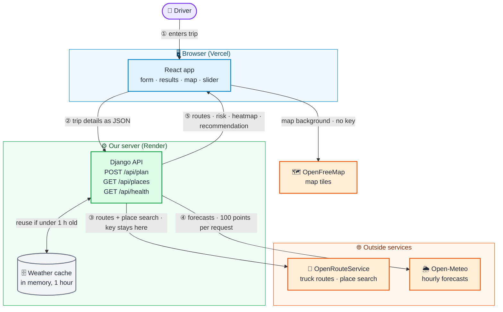
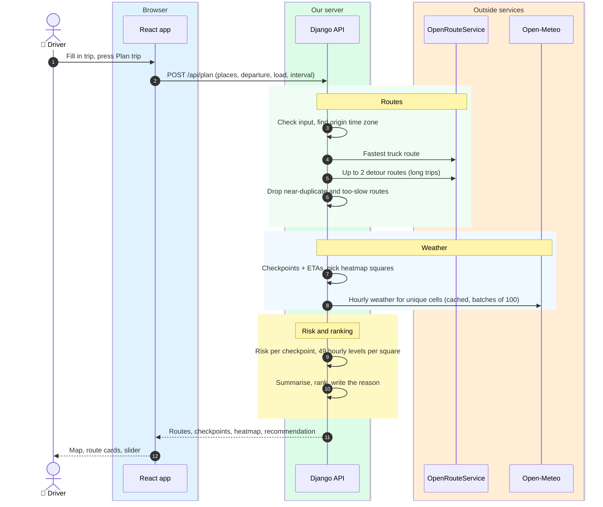
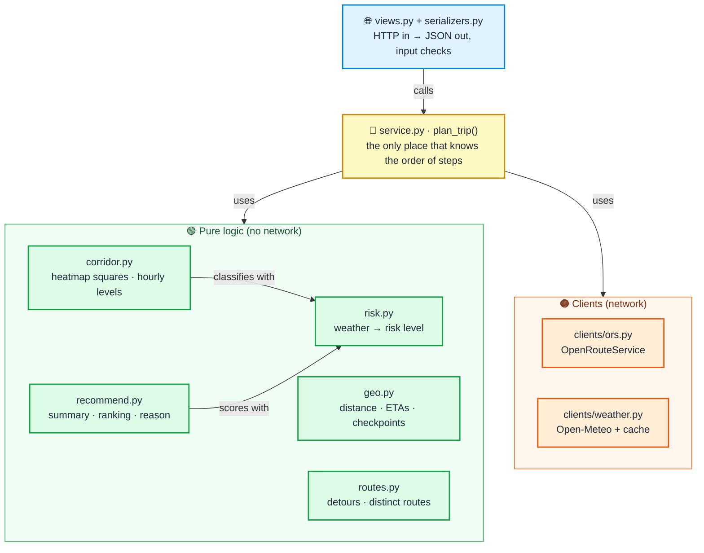
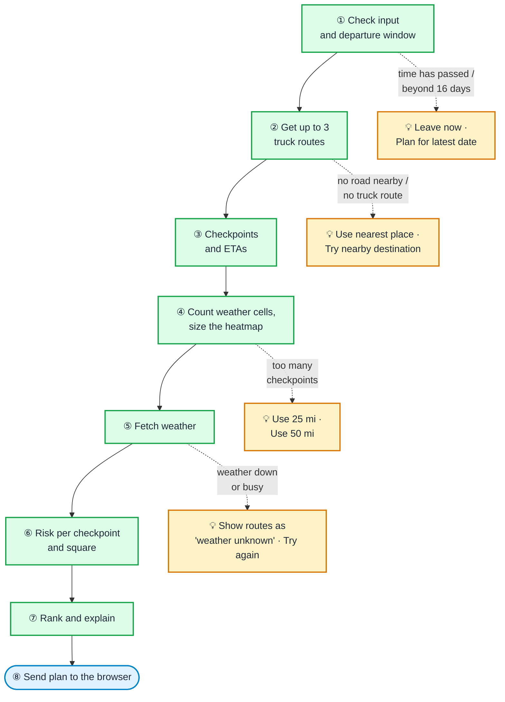
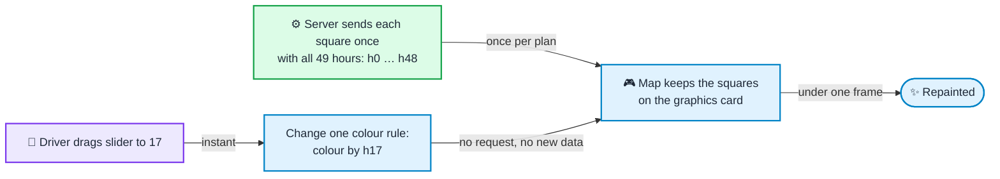
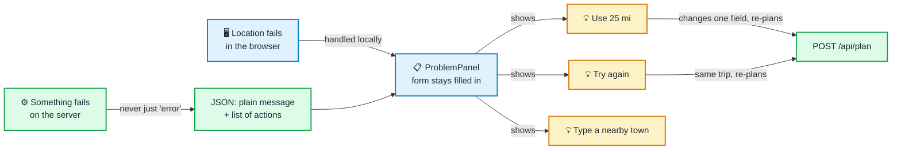

# Architecture

How the app is put together. The README shows the overview (diagram 1); this file has the detail.
Diagrams are written in Mermaid, which GitHub renders directly.

**Colour key used in every diagram**

| Colour | Meaning |
|---|---|
| 🟪 Purple | The driver |
| 🟦 Blue | Runs in the browser (React) |
| 🟩 Green | Runs on our server (Django) |
| 🟧 Orange | Outside services we call |
| ⬜ Grey | Stored data (cache) |
| 🟨 Yellow | Help shown to the driver when something fails |

## 1. System overview

- The browser only talks to **our API** and the **tile server**. The ORS key never reaches the browser.
- There is **no database**: every plan is calculated fresh; only weather is cached.

## 2. What happens when the driver presses "Plan trip"

If any step fails, the API sends back a plain message and suggested actions instead (diagram 7).

## 3. Backend modules: who may use whom

- Arrows point from the module that **imports** to the module it **uses**. Pure modules never import clients or Django.
- Tests never call real APIs: clients are tested with saved sample responses.

## 4. The plan pipeline, and the help offered where it can stop

## 5. Front end: components and state

```mermaid
flowchart TB
    App["🧠 App · holds all state<br/>form · plan · problem · loading<br/>selected route · slider hour · open popup"]

    subgraph formG["📝 Trip form"]
        direction TB
        Place["PlaceInput ×2<br/>search as you type"] ~~~ Dep["DepartureInput"] ~~~ Load["LoadInput (lb)"] ~~~ Int["IntervalToggle<br/>10 · 25 · 50 mi"]
    end

    subgraph resG["📋 Results panel"]
        direction TB
        Rec["Recommendation<br/>winner + reason"] ~~~ Cards["RouteCard ×3<br/>time · miles · risk"] ~~~ Problem["ProblemPanel<br/>message + buttons"]
    end

    subgraph mapG["🗺️ Map"]
        direction TB
        RL["RouteLayer<br/>coloured segments"] ~~~ CL["CheckpointLayer<br/>dots + popup"] ~~~ HL["HeatmapLayer<br/>coloured squares"]
    end

    subgraph sliderG["⏱️ Time"]
        direction TB
        Slider["HourSlider<br/>0–48 h"] ~~~ Legend["Legend<br/>level names"]
    end

    App -->|"form values"| formG
    App -->|"plan or problem"| resG
    App -->|"routes · selected · hour"| mapG
    App -->|"hour"| sliderG

    api["⚙️ Our API<br/>GET /api/places · POST /api/plan"]
    formG -. "search as you type" .-> api
    App -. "usePlan(): plan trip" .-> api

    classDef state fill:#ede9fe,stroke:#7c3aed,stroke-width:2px,color:#1f2937
    classDef comp fill:#e0f2fe,stroke:#0284c7,stroke-width:2px,color:#1f2937
    classDef endpoint fill:#dcfce7,stroke:#16a34a,stroke-width:2px,color:#1f2937
    class App state
    class Place,Dep,Load,Int,Rec,Cards,Problem,RL,CL,HL,Slider,Legend comp
    class api endpoint
    style formG fill:#f0f9ff,stroke:#0284c7,color:#0c4a6e
    style resG fill:#f0f9ff,stroke:#0284c7,color:#0c4a6e
    style mapG fill:#f0f9ff,stroke:#0284c7,color:#0c4a6e
    style sliderG fill:#f0f9ff,stroke:#0284c7,color:#0c4a6e
```

State lives only in `App` and flows **down** (solid arrows). Components report changes back **up**: picking a route card, moving the slider, editing the form. Dashed arrows are calls to our API.

## 6. Why the heatmap slider is smooth

## 7. How failures reach the driver

Unknown weather is never shown as Low, and a failure never clears what the driver typed.

## 8. Code conventions (for reviewers and AI tools)

Written so that a reviewer, or an AI assistant helping one, can follow the code quickly and not miss a rule:

- **Every function and every test has a one-line description** of what it does.
- **Where code implements an assumption, a comment cites its number**, e.g. `# #30: shared edge goes to the higher band`. Searching for `#30` finds the rule in the README, the code that implements it, and the test that proves it.
- **Assumption numbers never change.** New ones are added at the end.
- **Test names read as sentences**, e.g. `test_rain_at_0_25_is_high_because_higher_band_wins`, so a failing test explains itself.
- **No comments that repeat the code.** Comments explain *why*, not *what*.
